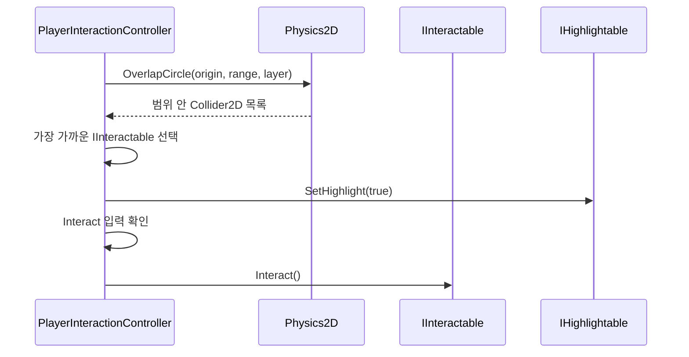

# Interaction 제작 가이드

이 문서는 팀원이 퍼즐, NPC, 문, 레버 같은 오브젝트를 Unity 인스펙터와 간단한 스크립트로 상호작용 가능하게 만들 수 있도록 정리한 작업 매뉴얼입니다.

목표는 단순합니다.

- 플레이어가 가까이 간 오브젝트를 자동으로 감지한다.
- 상호작용 가능한 대상에 하이라이트를 표시한다.
- `E` 키 또는 연결된 입력으로 `Interact()`를 실행한다.
- 퍼즐 오브젝트가 직접 문 열기, 레버 전환, 플래그 저장 같은 결과를 처리한다.
- 필요하면 진행 저장 시스템과 연결해서 씬을 나갔다 와도 상태를 유지한다.

---

## 1. 한 줄 요약

상호작용 시스템은 `PlayerInteractionController`가 주변의 `IInteractable` 오브젝트를 찾고, 입력이 들어오면 그 오브젝트의 `Interact()`를 호출하는 구조입니다.

```text
플레이어가 상호작용 범위에 들어감
-> PlayerInteractionController가 Layer + Collider2D로 후보 탐지
-> 가장 가까운 IInteractable 선택
-> IHighlightable이 있으면 SetHighlight(true)
-> 상호작용 입력
-> 현재 대상의 Interact() 실행
```

퍼즐 제작자가 가장 많이 기억해야 할 규칙은 이것입니다.

```text
상호작용될 오브젝트에는 Collider2D와 IInteractable 구현 스크립트가 필요하다.
```

---

## 2. 전체 구조 이해하기

상호작용은 크게 4가지 요소로 돌아갑니다.

| 요소 | 역할 |
| --- | --- |
| `PlayerInteractionController` | 플레이어 주변의 상호작용 대상을 찾고 입력을 처리합니다. |
| `IInteractable` | 상호작용 입력을 받을 수 있는 오브젝트 규약입니다. |
| `IHighlightable` | 상호작용 포커스가 잡혔을 때 하이라이트를 켜고 끄는 규약입니다. 선택 사항입니다. |
| `NpcDialogueInteractable` | `IInteractable`을 구현한 실제 예시입니다. NPC 대화를 시작합니다. |

현재 파일 위치:

```text
Assets/_Game/Scripts/
├── Gameplay/
│   ├── Interaction/
│   │   └── Contracts/
│   │       ├── IInteractable.cs
│   │       ├── IHighlightable.cs
│   │       └── ICameraTarget.cs
│   ├── Player/
│   │   └── PlayerInteractionController.cs
│   └── Dialogue/
│       └── NpcDialogueInteractable.cs
```

`ICameraTarget`도 같은 Interaction 폴더에 있지만, 플레이어가 `E`를 눌러 실행하는 상호작용과는 별개입니다. 카메라 추적 대상이 필요할 때 쓰는 인터페이스입니다.

---

## 3. 플레이 중 동작 흐름



중요한 점:

- 매 프레임 범위 안 대상을 다시 확인합니다.
- 범위 안에 여러 개가 있으면 가장 가까운 대상 하나만 선택합니다.
- 대상이 바뀌면 이전 대상의 하이라이트는 꺼지고 새 대상의 하이라이트가 켜집니다.
- 입력이 들어왔을 때 포커스된 대상이 없으면 아무 일도 일어나지 않습니다.

---

## 4. PlayerInteractionController 설정

플레이어 오브젝트에는 `PlayerInteractionController`가 붙어 있어야 합니다.

필드 설명:

| 필드 | 설명 |
| --- | --- |
| `Origin` | 탐지 원의 중심 위치입니다. 비워두면 플레이어 자신의 Transform을 씁니다. |
| `Layer` | 상호작용 대상으로 탐지할 LayerMask입니다. |
| `Interact Range` | 상호작용 탐지 반경입니다. 기본값은 `1.0`입니다. |
| `Interact Action` | 상호작용 입력 액션입니다. 현재 Input Actions의 `Player/Interact`를 연결합니다. |
| `Can Interact` | 상호작용 탐지와 입력 허용 여부입니다. 대화 중에는 false가 됩니다. |

현재 입력 액션 기준:

```text
Action Map: Player
Action: Interact
Keyboard: E
Gamepad: buttonNorth
```

설정 순서:

```text
1. Player 오브젝트 선택
2. PlayerInteractionController 확인
3. Origin에 탐지 기준 Transform 연결
4. Layer에 상호작용 오브젝트들이 사용할 Layer 선택
5. Interact Range 조정
6. Interact Action에 Player/Interact 연결
```

권장:

- `Origin`은 플레이어 발밑 또는 몸 중심에 둡니다.
- 대상을 쉽게 잡고 싶으면 `Interact Range`를 조금 넓힙니다.
- 너무 넓으면 의도하지 않은 오브젝트가 먼저 잡힐 수 있습니다.

---

## 5. 상호작용 대상 오브젝트 조건

상호작용 대상이 되려면 아래 조건을 만족해야 합니다.

```text
1. Collider2D가 있다.
2. Collider2D가 PlayerInteractionController의 LayerMask에 포함된 Layer에 있다.
3. Collider2D와 같은 GameObject에 IInteractable 구현 스크립트가 있다.
```

가장 안전한 하이어라키 예:

```text
Lever_01
├── SpriteRenderer
├── BoxCollider2D
├── SimpleLeverInteractable
└── Highlight
```

피해야 할 하이어라키:

```text
Lever_01
├── SimpleLeverInteractable
└── HitBox
    └── BoxCollider2D
```

현재 탐지 코드는 `hitCollider.GetComponent<IInteractable>()`를 사용합니다. 그래서 Collider2D가 자식에 있고 스크립트가 부모에 있으면 찾지 못합니다.

자식 Collider를 꼭 써야 한다면:

- Collider2D가 있는 자식에 `IInteractable` 구현 스크립트를 붙입니다.
- 또는 자식에 얇은 전달용 스크립트를 만들고 부모 퍼즐로 호출을 넘깁니다.

---

## 6. Layer 설정

상호작용 시스템은 모든 Collider를 보는 것이 아니라, `PlayerInteractionController`의 `Layer`에 들어간 Collider만 봅니다.

권장 작업:

```text
1. Project Settings > Tags and Layers에서 Interaction 같은 Layer 만들기
2. 상호작용 오브젝트의 Layer를 Interaction으로 설정
3. PlayerInteractionController의 LayerMask에 Interaction 체크
```

실수하기 쉬운 점:

- 오브젝트 루트의 Layer만 바꾸고 Collider가 있는 자식 Layer를 안 바꾸면 탐지되지 않을 수 있습니다.
- LayerMask에 체크되지 않은 Layer는 범위 안에 있어도 무시됩니다.
- UI Button의 `Interactable`과 이 문서의 `IInteractable`은 다른 개념입니다.

---

## 7. Collider2D 설정

상호작용 대상에는 `BoxCollider2D`, `CircleCollider2D`, `CapsuleCollider2D` 같은 2D Collider가 필요합니다.

권장:

```text
Collider2D: 있음
Is Trigger: 켜도 됨
Layer: Interaction
Size: 플레이어가 말 걸거나 조작할 수 있는 거리보다 너무 작지 않게
```

퍼즐에서 물리 충돌이 필요 없다면 `Is Trigger`를 켜두는 편이 편합니다.

주의:

- Collider가 너무 작으면 플레이어가 딱 붙어야만 잡힙니다.
- Collider가 너무 크면 멀리 있는 대상이 먼저 잡힐 수 있습니다.
- 같은 범위 안에 상호작용 Collider가 너무 많으면 가장 가까운 대상만 실행됩니다.
- 현재 탐지 버퍼는 한 번에 10개까지 받습니다. 상호작용 대상이 한 위치에 과도하게 겹치지 않게 배치하세요.

---

## 8. IInteractable 이해하기

`IInteractable`은 상호작용 입력을 받을 수 있다는 표시입니다.

```csharp
public interface IInteractable
{
    void Interact();
}
```

플레이어가 상호작용 입력을 누르면 현재 포커스된 대상의 `Interact()`가 호출됩니다.

예:

```csharp
using UnityEngine;

public class SimpleLeverInteractable : MonoBehaviour, IInteractable
{
    [Header("Lever")]
    [SerializeField] private Animator _animator;

    private bool _isOn;

    public void Interact()
    {
        _isOn = !_isOn;
        ApplyVisual();
    }

    private void ApplyVisual()
    {
        if (_animator != null)
        {
            _animator.SetBool("IsOn", _isOn);
        }
    }
}
```

이 스크립트를 붙이면 플레이어가 범위 안에서 상호작용 입력을 눌렀을 때 레버가 켜짐/꺼짐 상태를 바꿉니다.

---

## 9. IHighlightable 이해하기

`IHighlightable`은 상호작용 포커스가 잡혔는지 알려주는 선택 인터페이스입니다.

```csharp
public interface IHighlightable
{
    void SetHighlight(bool isActive);
}
```

`IHighlightable`을 구현하지 않아도 상호작용은 됩니다. 다만 플레이어가 어떤 대상과 상호작용할 수 있는지 시각적으로 표시되지 않습니다.

가장 단순한 하이라이트 예:

```csharp
using UnityEngine;

public class HighlightOnlyExample : MonoBehaviour, IHighlightable
{
    [Header("Highlight")]
    [SerializeField] private GameObject _highlightObject;

    private void Awake()
    {
        SetHighlight(false);
    }

    public void SetHighlight(bool isActive)
    {
        if (_highlightObject != null)
        {
            _highlightObject.SetActive(isActive);
        }
    }
}
```

실전에서는 보통 `IInteractable`과 `IHighlightable`을 같은 스크립트에서 같이 구현합니다.

---

## 10. 기본 퍼즐 예시: 하이라이트되는 레버

새 레버를 만들 때 가장 기본이 되는 형태입니다.

```csharp
using UnityEngine;

[DisallowMultipleComponent]
public class LeverInteractable : MonoBehaviour, IInteractable, IHighlightable
{
    [Header("Lever")]
    [SerializeField] private Animator _animator;

    [Header("Highlight")]
    [SerializeField] private GameObject _highlightObject;

    private bool _isOn;

    private void Awake()
    {
        SetHighlight(false);
        ApplyVisual();
    }

    public void Interact()
    {
        _isOn = !_isOn;
        ApplyVisual();
    }

    public void SetHighlight(bool isActive)
    {
        if (_highlightObject != null)
        {
            _highlightObject.SetActive(isActive);
        }
    }

    private void ApplyVisual()
    {
        if (_animator != null)
        {
            _animator.SetBool("IsOn", _isOn);
        }
    }
}
```

Unity에서 설정:

```text
Lever_01
Layer: Interaction
Components:
  BoxCollider2D
  LeverInteractable

LeverInteractable:
  Animator: 레버 Animator
  Highlight Object: 하이라이트용 자식 오브젝트
```

동작:

```text
플레이어가 레버 근처로 이동
-> Highlight Object 켜짐
-> E 입력
-> Interact()
-> _isOn 값 토글
-> Animator의 IsOn 값 변경
```

---

## 11. NPC 대화 상호작용 예시

`NpcDialogueInteractable`은 이미 구현되어 있는 상호작용 컴포넌트입니다.

하는 일:

```text
Interact()
-> GameRoot.Dialogue 조회
-> NPC ID로 퀘스트 상태에 맞는 CSV graph_id 선택
-> 대화 시작
```

필드:

| 필드 | 설명 |
| --- | --- |
| `Npc Id` | `npc_dialogue_bindings.csv`의 `npc_id`와 일치하는 NPC 고유 ID입니다. |
| `Highlight Object` | 포커스가 잡혔을 때 켜질 오브젝트입니다. |
| `Hide Highlight On Awake` | 시작할 때 하이라이트를 숨길지 여부입니다. |

NPC를 만들 때는 별도 스크립트를 만들지 않고 이 컴포넌트를 사용하면 됩니다.

퍼즐은 NPC와 달리 결과가 제각각이므로, 보통 직접 `IInteractable`을 구현합니다.

---

## 12. 문을 여는 레버 예시

레버가 문을 열어야 한다면, 레버와 문을 나눠서 생각하면 쉽습니다.

```text
LeverInteractable
-> 플레이어 입력을 받음
-> 상태를 바꿈
-> DoorPuzzleTarget에게 열림/닫힘 전달
```

문 스크립트:

```csharp
using UnityEngine;

public class DoorPuzzleTarget : MonoBehaviour
{
    [Header("Door")]
    [SerializeField] private Animator _animator;

    private bool _isOpen;

    public void SetOpen(bool isOpen)
    {
        _isOpen = isOpen;
        ApplyVisual();
    }

    private void ApplyVisual()
    {
        if (_animator != null)
        {
            _animator.SetBool("IsOpen", _isOpen);
        }
    }
}
```

레버 스크립트:

```csharp
using UnityEngine;

public class DoorLeverInteractable : MonoBehaviour, IInteractable, IHighlightable
{
    [Header("Lever")]
    [SerializeField] private Animator _leverAnimator;

    [Header("Target")]
    [SerializeField] private DoorPuzzleTarget _door;

    [Header("Highlight")]
    [SerializeField] private GameObject _highlightObject;

    private bool _isOn;

    private void Awake()
    {
        SetHighlight(false);
        ApplyVisual();
    }

    public void Interact()
    {
        _isOn = !_isOn;
        ApplyVisual();
    }

    public void SetHighlight(bool isActive)
    {
        if (_highlightObject != null)
        {
            _highlightObject.SetActive(isActive);
        }
    }

    private void ApplyVisual()
    {
        if (_leverAnimator != null)
        {
            _leverAnimator.SetBool("IsOn", _isOn);
        }

        if (_door != null)
        {
            _door.SetOpen(_isOn);
        }
    }
}
```

인스펙터 설정:

```text
DoorLeverInteractable
Lever Animator: 레버 Animator
Door: 열릴 문 오브젝트의 DoorPuzzleTarget
Highlight Object: 하이라이트 자식 오브젝트
```

---

## 13. 씬을 나갔다 와도 유지되는 퍼즐

레버를 당긴 뒤 다른 씬에 갔다 오면 상태가 유지되어야 하는 퍼즐은 `ISceneStateContributor`도 같이 구현합니다.

상태 데이터:

```csharp
[System.Serializable]
public class LeverDoorState
{
    public bool isOn;
}
```

저장되는 레버 예:

```csharp
using UnityEngine;

[DisallowMultipleComponent]
public class SavedDoorLeverInteractable : MonoBehaviour, IInteractable, IHighlightable, ISceneStateContributor
{
    [Header("Progress")]
    [SerializeField] private string _objectId = "RoomA_Lever_Door01";

    [Header("Lever")]
    [SerializeField] private Animator _leverAnimator;

    [Header("Target")]
    [SerializeField] private DoorPuzzleTarget _door;

    [Header("Highlight")]
    [SerializeField] private GameObject _highlightObject;

    private bool _isOn;

    public string ObjectId => _objectId;

    private void Awake()
    {
        SetHighlight(false);
        ApplyVisual();
    }

    public void Interact()
    {
        SetLever(!_isOn);
    }

    public void SetHighlight(bool isActive)
    {
        if (_highlightObject != null)
        {
            _highlightObject.SetActive(isActive);
        }
    }

    public string CaptureState()
    {
        return JsonUtility.ToJson(new LeverDoorState { isOn = _isOn });
    }

    public void ApplyState(string stateJson)
    {
        if (string.IsNullOrWhiteSpace(stateJson))
        {
            ApplyVisual();
            return;
        }

        LeverDoorState state = JsonUtility.FromJson<LeverDoorState>(stateJson);
        SetLever(state.isOn);
    }

    private void SetLever(bool isOn)
    {
        _isOn = isOn;
        ApplyVisual();
    }

    private void ApplyVisual()
    {
        if (_leverAnimator != null)
        {
            _leverAnimator.SetBool("IsOn", _isOn);
        }

        if (_door != null)
        {
            _door.SetOpen(_isOn);
        }
    }
}
```

이 패턴을 쓰면:

```text
레버를 당김
-> _isOn = true
-> 씬을 떠날 때 SceneStateBridge가 CaptureState() 호출
-> ProgressController에 JSON 저장
-> 씬에 다시 들어올 때 ApplyState() 호출
-> 레버와 문이 다시 열린 상태로 복원
```

`_objectId` 규칙:

```text
{스테이지약어}_{종류}_{설명}

예:
RoomA_Lever_Door01
RoomA_Statue_Switch03
RoomB_Chest_Key
```

`_objectId`는 같은 스테이지 안에서 중복되면 안 됩니다. 한 번 정한 뒤에는 가능하면 바꾸지 마세요.

---

## 14. Progress Flag와 연결하기

상호작용 결과를 대화, 퀘스트, 다른 퍼즐에서 읽어야 한다면 `Progress Flag`를 같이 저장할 수 있습니다.

예:

```csharp
using UnityEngine;

public class FlagSwitchInteractable : MonoBehaviour, IInteractable
{
    [Header("Progress")]
    [SerializeField] private string _flagId = "puzzle_room_a_switch_on";

    public void Interact()
    {
        if (!GameRoot.TryGetInstance(out GameRoot gameRoot) || gameRoot.Progress == null)
        {
            return;
        }

        gameRoot.Progress.SetFlag(_flagId, true);

        if (gameRoot.Quest != null)
        {
            gameRoot.Quest.RefreshAllInProgressQuests();
        }
    }
}
```

퀘스트 목표에서 같은 flag를 검사하게 만들 수 있습니다.

```text
Quest Objective
Required Progress Flag Id: puzzle_room_a_switch_on
Required Flag Value: true
```

동작:

```text
스위치 상호작용
-> puzzle_room_a_switch_on = true
-> 진행 중인 퀘스트 목표 다시 검사
-> 조건이 맞으면 QUEST_COMPLETED로 변경
```

중요:

- 대화 선택지의 `SET_PROGRESS_FLAG_TRUE`는 내부에서 자동으로 `RefreshAllInProgressQuests()`를 호출합니다.
- 퍼즐 스크립트가 직접 `Progress.SetFlag()`를 호출할 때도 퀘스트 목표 갱신이 필요하면 `RefreshAllInProgressQuests()`를 같이 호출하세요.
- 단순히 같은 씬의 문 열림 상태만 저장하면 된다면 `Progress Flag`보다 `ISceneStateContributor`가 더 적합합니다.

---

## 15. 어떤 저장 방식을 써야 하나?

퍼즐 결과를 저장할 때는 목적에 따라 나눕니다.

| 상황 | 추천 방식 |
| --- | --- |
| 이 씬에 다시 왔을 때 레버/문/상자가 같은 상태여야 함 | `ISceneStateContributor` |
| 다른 씬, 퀘스트, 대화에서 조건으로 읽어야 함 | `Progress Flag` |
| 둘 다 필요함 | `ISceneStateContributor`와 `Progress Flag` 둘 다 사용 |
| 한 번 상호작용하면 그 자리에서만 애니메이션 재생하고 끝 | 별도 저장 없음 |

예:

```text
레버를 당기면 같은 방의 문이 열린다
-> ISceneStateContributor

레버를 당기면 장로 대화가 바뀐다
-> Progress Flag

레버를 당기면 문도 열린 채 유지되고, 퀘스트도 완료된다
-> ISceneStateContributor + Progress Flag
```

---

## 16. 대상 선택 규칙

범위 안에 상호작용 대상이 여러 개 있으면 가장 가까운 대상 하나만 선택됩니다.

기준:

```text
PlayerInteractionController의 Origin 위치
-> Collider2D가 있는 GameObject의 Transform 위치
-> 가장 거리가 가까운 IInteractable 선택
```

배치 팁:

- 작은 레버와 큰 문 Collider가 겹치면 가까운 쪽만 실행됩니다.
- 문 앞에 레버가 붙어 있다면 Collider 크기와 Transform 위치를 확인하세요.
- 같은 위치에 여러 상호작용 오브젝트를 겹쳐 두지 않는 것이 좋습니다.
- 같은 퍼즐의 여러 부품이 하나의 결과를 내야 한다면, 대표 오브젝트 하나만 `IInteractable`로 만들고 나머지는 시각 요소로 두는 편이 안전합니다.

---

## 17. 입력 잠금

`PlayerInteractionController`에는 `SetCanInteract(bool)` API가 있습니다.

```csharp
public void SetCanInteract(bool canInteract)
```

현재 대화 시스템은 대화 중 플레이어 상호작용을 막기 위해 이 값을 false로 바꿉니다.

동작:

```text
SetCanInteract(false)
-> 현재 대상 해제
-> 하이라이트 꺼짐
-> 탐지와 입력 처리 중단

SetCanInteract(true)
-> 다시 주변 대상 탐지 시작
```

퍼즐 컷신, UI, 미니게임 중에 상호작용을 막아야 한다면 같은 API를 사용할 수 있습니다.

---

## 18. 실전 예시: 유적 문 레버 만들기

목표:

```text
플레이어가 레버 근처로 간다.
레버 하이라이트가 켜진다.
E를 누르면 레버가 내려간다.
문이 열린다.
씬을 나갔다 와도 문이 열린 상태로 유지된다.
퀘스트 목표 flag도 켜진다.
```

### 18-1. 오브젝트 배치

```text
RoomA
├── Puzzle_Door_Ancient
│   ├── Animator
│   └── DoorPuzzleTarget
│
└── Puzzle_Lever_AncientDoor
    ├── SpriteRenderer
    ├── BoxCollider2D
    ├── SavedDoorLeverInteractable
    └── Highlight
```

`Puzzle_Lever_AncientDoor` 설정:

```text
Layer: Interaction
BoxCollider2D:
  Is Trigger: true
SavedDoorLeverInteractable:
  Object Id: RoomA_Lever_AncientDoor
  Lever Animator: 레버 Animator
  Door: Puzzle_Door_Ancient
  Highlight Object: Highlight
```

### 18-2. 퀘스트 flag가 필요하다면

레버 스크립트에 flag 필드를 추가합니다.

```csharp
[Header("Progress")]
[SerializeField] private string _solvedFlagId = "puzzle_room_a_ancient_door_opened";
```

`SetLever()`에서 켭니다.

```csharp
private void SetLever(bool isOn)
{
    _isOn = isOn;
    ApplyVisual();

    if (_isOn && GameRoot.TryGetInstance(out GameRoot gameRoot) && gameRoot.Progress != null)
    {
        gameRoot.Progress.SetFlag(_solvedFlagId, true);

        if (gameRoot.Quest != null)
        {
            gameRoot.Quest.RefreshAllInProgressQuests();
        }
    }
}
```

퀘스트 목표:

```text
Objective Id: open_ancient_door
Description: 유적 문을 열기
Required Progress Flag Id: puzzle_room_a_ancient_door_opened
Required Flag Value: true
```

### 18-3. 플레이 테스트 흐름

```text
1. Play 시작
2. 레버 근처로 이동
3. Highlight가 켜지는지 확인
4. E 입력
5. 레버 애니메이션과 문 애니메이션 확인
6. 다른 스테이지로 이동
7. 다시 돌아오기
8. 레버와 문 상태가 유지되는지 확인
9. 퀘스트 목표가 완료되는지 확인
```

---

## 19. 상호작용 패턴

### 패턴 A: 한 번 조사하는 오브젝트

```csharp
public class InspectObjectInteractable : MonoBehaviour, IInteractable
{
    public void Interact()
    {
        Debug.Log("오래된 비문이다.");
    }
}
```

대화 UI나 알림 UI가 붙기 전까지 테스트용으로 쓰기 좋습니다.

### 패턴 B: 레버 토글

```text
Interact()
-> bool 값 반전
-> 애니메이터 파라미터 변경
-> 연결된 문/장치에 상태 전달
```

반복해서 켜고 끌 수 있는 퍼즐에 씁니다.

### 패턴 C: 한 번만 작동하는 스위치

```csharp
private bool _used;

public void Interact()
{
    if (_used)
    {
        return;
    }

    _used = true;
    // 보상 지급, 문 열기, flag 저장
}
```

상자, 아이템 획득, 일회성 버튼에 씁니다.

### 패턴 D: 조건부 상호작용

```csharp
public void Interact()
{
    if (!GameRoot.TryGetInstance(out GameRoot gameRoot) || gameRoot.Progress == null)
    {
        return;
    }

    if (gameRoot.Progress.GetFlag("item_key_main_hall") == false)
    {
        Debug.Log("열쇠가 필요하다.");
        return;
    }

    OpenDoor();
}
```

열쇠, 선행 퍼즐, 스토리 조건이 필요한 문에 씁니다.

### 패턴 E: NPC 대화

```text
NpcDialogueInteractable 사용
Npc Id 입력
npc_dialogue_bindings.csv에 기본 graph_id 연결
npc_quest_dialogue_routes.csv에 퀘스트 상태별 경로 설정
```

대화와 퀘스트는 직접 퍼즐 스크립트를 만들기보다 기존 `NpcDialogueInteractable`을 사용하세요.

---

## 20. 검수 체크리스트

새 상호작용 오브젝트를 만든 뒤 아래를 확인하세요.

### Player

- `PlayerInteractionController`가 붙어 있는가?
- `Interact Action`에 `Player/Interact`가 연결되어 있는가?
- `Layer`에 상호작용 오브젝트 Layer가 포함되어 있는가?
- `Interact Range`가 너무 작거나 크지 않은가?
- `Can Interact`가 true인가?

### Interactable Object

- `Collider2D`가 있는가?
- Collider가 있는 GameObject에 `IInteractable` 구현 스크립트가 있는가?
- 오브젝트 Layer가 Player의 Interaction LayerMask에 포함되는가?
- Collider 크기가 적절한가?
- 여러 대상이 겹쳐 있어서 다른 오브젝트가 먼저 잡히지 않는가?

### Highlight

- 하이라이트가 필요하면 `IHighlightable`을 구현했는가?
- `Highlight Object`가 연결되어 있는가?
- 시작할 때 하이라이트가 꺼져 있는가?
- 포커스가 빠질 때 `SetHighlight(false)`로 정상적으로 꺼지는가?

### Puzzle Result

- `Interact()` 안에서 원하는 결과가 실제로 실행되는가?
- 문/레버 Animator 파라미터 이름이 코드와 같은가?
- 연결 대상 필드가 인스펙터에 비어 있지 않은가?
- 한 번만 작동해야 하는 퍼즐은 중복 실행 방지가 있는가?

### Save / Progress

- 씬 왕복 후 상태 유지가 필요하면 `ISceneStateContributor`를 구현했는가?
- `Object Id`가 같은 스테이지 안에서 유일한가?
- 다른 시스템에서 읽어야 하면 `Progress Flag`를 저장했는가?
- 퀘스트 목표 갱신이 필요하면 `RefreshAllInProgressQuests()`를 호출했는가?

---

## 21. 자주 생기는 문제

### 가까이 가도 하이라이트가 안 켜진다

확인할 것:

- `IHighlightable`을 구현했는가?
- `Highlight Object`가 연결되어 있는가?
- `SetHighlight(true)`에서 실제로 오브젝트를 켜는가?
- 플레이어의 `Layer`와 대상 오브젝트 Layer가 맞는가?
- 대상에 Collider2D가 있는가?

### E를 눌러도 아무 일도 안 일어난다

확인할 것:

- 플레이어의 `Interact Action`이 연결되어 있는가?
- 현재 입력 액션이 `Player/Interact`인가?
- 대상 Collider와 `IInteractable` 스크립트가 같은 GameObject에 있는가?
- `Can Interact`가 false가 아닌가?
- 대화나 UI가 열려 있어 상호작용이 잠긴 상태는 아닌가?

### 다른 오브젝트가 상호작용된다

확인할 것:

- 범위 안에 더 가까운 `IInteractable`이 있는가?
- 두 오브젝트의 Collider가 겹쳐 있는가?
- Collider가 있는 GameObject의 Transform 위치가 의도와 다른가?
- `Interact Range`가 너무 넓지 않은가?

### Collider를 자식에 뒀더니 작동하지 않는다

현재 탐지 코드는 Collider가 감지된 GameObject에서 바로 `GetComponent<IInteractable>()`를 호출합니다.

해결:

- Collider가 있는 자식에 상호작용 스크립트도 붙입니다.
- 또는 Collider와 상호작용 스크립트를 같은 루트 오브젝트로 옮깁니다.

### 씬을 나갔다 오면 퍼즐이 초기화된다

확인할 것:

- 상태 유지가 필요한 오브젝트가 `ISceneStateContributor`를 구현했는가?
- `ObjectId`가 비어 있지 않은가?
- `CaptureState()`가 유효한 JSON을 반환하는가?
- `ApplyState()`에서 저장된 값을 다시 시각 상태에 반영하는가?
- 해당 씬이 StageFlow/SceneStateBridge 흐름으로 전환되는가?

### 퀘스트 목표가 완료되지 않는다

확인할 것:

- 퍼즐에서 켠 flag ID와 퀘스트 Objective의 `Required Progress Flag Id`가 완전히 같은가?
- `Required Flag Value`가 `true`인가?
- 퀘스트가 `QUEST_IN_PROGRESS` 상태인가?
- 퍼즐에서 `Progress.SetFlag()` 후 `Quest.RefreshAllInProgressQuests()`를 호출했는가?

### NPC 대화는 되는데 퍼즐은 안 된다

NPC는 `NpcDialogueInteractable`이 이미 `IInteractable`을 구현하고 있습니다.

퍼즐은 직접 구현해야 합니다.

```text
public class MyPuzzle : MonoBehaviour, IInteractable
{
    public void Interact()
    {
        // 퍼즐 결과
    }
}
```

---

## 22. 추천 작업 순서

새 퍼즐 상호작용을 만들 때는 아래 순서로 작업하면 실수가 적습니다.

```text
1. 퍼즐 오브젝트를 씬에 배치
2. Collider2D 추가
3. Layer를 Interaction으로 설정
4. IInteractable 구현 스크립트 작성
5. Interact() 안에 가장 단순한 Debug.Log 또는 상태 토글 작성
6. 플레이해서 하이라이트와 입력 확인
7. 문, 레버, 애니메이터 같은 실제 결과 연결
8. 하이라이트가 필요하면 IHighlightable 구현
9. 씬 왕복 상태 유지가 필요하면 ISceneStateContributor 구현
10. 퀘스트/대화 조건이 필요하면 Progress Flag 저장
11. Play에서 가까이 가기, 입력, 씬 왕복, 퀘스트 갱신까지 검수
```

처음부터 저장, 퀘스트, 애니메이션을 모두 붙이면 어디서 문제가 났는지 찾기 어렵습니다. 먼저 `Interact()`가 호출되는지 확인하고, 그 다음 결과를 하나씩 붙이는 방식이 가장 안전합니다.

---

## 23. 빠른 참조

### 필수 인터페이스

```csharp
public interface IInteractable
{
    void Interact();
}
```

### 선택 인터페이스

```csharp
public interface IHighlightable
{
    void SetHighlight(bool isActive);
}
```

### 저장 인터페이스

```csharp
public interface ISceneStateContributor
{
    string ObjectId { get; }
    string CaptureState();
    void ApplyState(string stateJson);
}
```

### 전역 진행 접근

```csharp
GameRoot.Instance.Progress.SetFlag("flag_id", true);
bool value = GameRoot.Instance.Progress.GetFlag("flag_id");
```

### 퀘스트 목표 갱신

```csharp
GameRoot.Instance.Quest.RefreshAllInProgressQuests();
```

---

## 24. 관련 문서

```text
Assets/_Game/Docs/DIALOGUE_QUEST_AUTHORING_GUIDE.md
Assets/_Game/Docs/PROGRESS_SYSTEM_GUIDE.md
```

상호작용으로 대화를 시작하는 방법은 `DIALOGUE_QUEST_AUTHORING_GUIDE.md`의 `NpcDialogueInteractable` 부분을 보면 됩니다.

상호작용 결과를 씬 왕복 후에도 저장하는 방법은 `PROGRESS_SYSTEM_GUIDE.md`의 `ISceneStateContributor` 부분을 보면 됩니다.

---

## 25. 요약

상호작용 대상 제작의 핵심은 5가지입니다.

```text
1. Collider2D가 있어야 한다.
2. LayerMask에 포함된 Layer여야 한다.
3. Collider와 같은 GameObject에 IInteractable이 있어야 한다.
4. 하이라이트가 필요하면 IHighlightable을 구현한다.
5. 상태 유지가 필요하면 ISceneStateContributor 또는 Progress Flag를 쓴다.
```

이 규칙만 지키면 NPC, 레버, 문, 상자, 조사 포인트 같은 대부분의 상호작용 오브젝트를 같은 방식으로 만들 수 있습니다.
