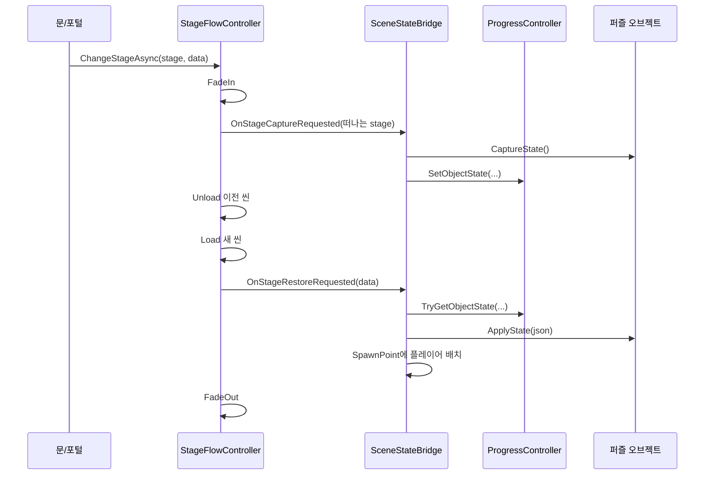

# 진행 상태(Progress) 시스템 가이드

2D 퍼즐 어드벤처에서 **씬을 나갔다 와도 퍼즐·맵 진행이 초기화되지 않도록** 저장하는 방법을 설명합니다.

---

## 1. 한 줄 요약


| 역할             | 담당 클래스                | 무엇을 저장하나                       |
| -------------- | --------------------- | ------------------------------ |
| **씬 전환**       | `StageFlowController` | 전환 타이밍만 (페이드, 로드, 언로드)         |
| **진행 저장소**     | `ProgressController`  | 플래그, 퍼즐/오브젝트 상태                |
| **자동 연결**      | `SceneStateBridge`    | Capture/Restore 시 퍼즐 ↔ 저장소 동기화 |
| **전환 handoff** | `SceneTransferData`   | 이번 전환에서만 필요한 정보 (스폰 ID 등)      |


> **핵심 규칙:** 퍼즐·맵 진행 데이터는 `ProgressController`에 넣고, `SceneTransferData`에는 넣지 않습니다.

---

## 2. 왜 이렇게 나눴나?

스테이지 씬은 Additive로 로드했다가 **언로드**됩니다. 씬이 내려가면 그 안의 MonoBehaviour 필드 값은 전부 사라집니다.

```
Room A에서 레버 당김 → Room B로 이동 → Room A 복귀
         ↓                    ↓                ↓
   씬 언로드됨          (A 상태 소멸)     씬 다시 로드
                                              ↓
                                    저장소에서 상태 복원 필요
```

그래서 **씬 밖(Persistent / GameRoot)** 에 `ProgressController`라는 "창고"를 두고, 씬을 떠날 때 저장·들어올 때 복원합니다.

---

## 3. 전체 흐름 (씬 전환 시)




**개발자가 직접 Capture/Restore를 호출할 필요는 없습니다.**  
퍼즐만 `ISceneStateContributor`로 등록하면 `SceneStateBridge`가 자동 처리합니다.

---

## 4. 진행 데이터 3종류 — 무엇을 어디에 등록하나?

### 4.1 전역 플래그 (Global Flag)

**용도:** 씬을 넘나드는 진행 — 아이템 획득, 스토리 분기, "보스 처치" 등


| 항목    | 내용                                             |
| ----- | ---------------------------------------------- |
| 저장 위치 | `ProgressController` (메모리)                     |
| API   | `GameRoot.Instance.Progress.SetFlag / GetFlag` |
| 키     | 문자열 ID (예: `"item_key_main_hall"`)             |
| 등록 방법 | 코드에서 직접 Set/Get (인스펙터 등록 없음)                   |


```csharp
// 열쇠 획득 시
GameRoot.Instance.Progress.SetFlag("item_key_main_hall", true);

// 다른 씬의 문에서 확인
if (GameRoot.Instance.Progress.GetFlag("item_key_main_hall"))
{
    OpenDoor();
}
```

**언제 쓰나**

- 여러 스테이지에 걸친 조건
- NPC 대화 완료, 컷신 본 적 있음
- 인벤토리에 "있음/없음"만 필요한 아이템

---

### 4.2 씬 오브젝트 상태 (Scene Object State)

**용도:** 특정 방/스테이지 안 오브젝트의 물리적·시각적 상태 — 문 열림, 레버 각도, 상자 내용물 등


| 항목       | 내용                                      |
| -------- | --------------------------------------- |
| 저장 위치    | `ProgressController` (메모리, JSON blob)   |
| 등록 방법    | `**ISceneStateContributor` 구현** + 씬에 배치 |
| 키        | `(stageNumber, objectId)`               |
| 자동 저장/복원 | `SceneStateBridge` (씬 전환 시)             |


**언제 쓰나**

- 그 스테이지에 다시 돌아왔을 때 **똑같이 보여야 하는 것**
- 레버, 스위치, 문, 파괴된 상자, 이동한 블록

---

### 4.3 씬 전환 handoff (SceneTransferData)

**용도:** **이번 전환 한 번**에만 필요한 정보


| 항목     | 내용                                          |
| ------ | ------------------------------------------- |
| 필드     | `targetSpawnPointId`, `enteringStageNumber` |
| 누가 채우나 | 문/포털 등 **전환을 호출하는 쪽**                       |
| 저장소    | 저장하지 않음 (전달용 택배 상자)                         |


```csharp
var data = new SceneTransferData(
    targetSpawnPointId: "Spawn_FromRoomA",
    enteringStageNumber: 2   // 생략 가능 — StageFlow가 자동 채움
);

await GameRoot.Instance.StageFlow.ChangeStageAsync(2, data);
```

**언제 쓰나**

- 어느 SpawnPoint에 서 있게 할지
- (선택) 목적지 스테이지 번호 명시

**넣으면 안 되는 것:** 열쇠 개수, 레버 상태, NPC 진행도 → 전부 `ProgressController`로

---

## 5. 사전 설정 (맵/스테이지 작업 전)

### 5.1 SceneCatalogSO에 스테이지 등록

`Assets/_Game/Data/SceneCatalog/SceneCatalogSO.asset` 에서 각 스테이지를 등록합니다.


| 필드             | 예시        | 설명                                 |
| -------------- | --------- | ---------------------------------- |
| Scene Id       | `VZ`      | 안정적인 식별자 (코드/세이브 키용)               |
| Scene Name     | `VZScene` | Unity Build Settings 씬 이름          |
| Scene Category | **STAGE** | 스테이지는 반드시 STAGE                    |
| Stage Number   | `1`       | `ChangeStageAsync(1, ...)` 에 쓰는 번호 |


> **주의:** Stage Number는 프로젝트 전체에서 **중복되면 안 됩니다.**  
> 저장 키 `(stageNumber, objectId)` 가 여기에 의존합니다.

### 5.2 GameRoot 프리팹 확인

`GameRoot` 오브젝트에 아래 컴포넌트가 연결되어 있어야 합니다.

- `ProgressController`
- `StageFlowController`
- `SceneStateBridge`
- `GameRoot` 스크립트의 Serialize 필드 참조 연결

---

## 6. 맵 연결 (방 ↔ 방 이동) 등록 방법

### Step 1 — 목적지 씬에 SpawnPoint 배치

1. 이동 **목적지** 스테이지 씬을 엽니다.
2. 들어왔을 때 서 있을 위치에 빈 GameObject + `SpawnPoint` 컴포넌트 추가.
3. **Spawn Point Id** 를 고유 문자열로 설정 (예: `Spawn_FromRoomA`).

```
Room B 씬
  └── SpawnPoints/
        └── Spawn_FromRoomA   ← Room A에서 B로 올 때 도착 지점
              _spawnPointId = "Spawn_FromRoomA"
```

### Step 2 — 출발지 씬에 포털(문) 스크립트 작성

포털이 `ChangeStageAsync` 를 호출합니다.

```csharp
using Cysharp.Threading.Tasks;
using UnityEngine;

public class StagePortal : MonoBehaviour
{
    [Header("Portal")]
    [SerializeField] private int _destinationStageNumber = 2;

    [Header("Portal")]
    [SerializeField] private string _targetSpawnPointId = "Spawn_FromRoomA";

    public async void OnPlayerEnter()
    {
        var data = new SceneTransferData(_targetSpawnPointId, _destinationStageNumber);

        await GameRoot.Instance.StageFlow.ChangeStageAsync(_destinationStageNumber, data);
    }
}
```

### Step 3 — 양방향 이동


| 방향         | destinationStageNumber | targetSpawnPointId       |
| ---------- | ---------------------- | ------------------------ |
| Room A → B | `2` (B의 stage number)  | B 씬의 `"Spawn_FromRoomA"` |
| Room B → A | `1` (A의 stage number)  | A 씬의 `"Spawn_FromRoomB"` |


각 목적지 씬에 **들어오는 방향마다** SpawnPoint 하나씩 두면 됩니다.

---

## 7. 퍼즐 등록 방법 (ISceneStateContributor)

### Step 1 — 상태 POCO 정의

퍼즐마다 **저장할 필드만** 담은 직렬화 가능 클래스를 만듭니다.

```csharp
[System.Serializable]
public class DoorState
{
    public bool isOpen;
}
```

### Step 2 — 퍼즐 스크립트 구현

```csharp
using UnityEngine;

public class DoorController : MonoBehaviour, ISceneStateContributor
{
    [Header("Progress")]
    [SerializeField] private string _objectId = "RoomA_Door_Main";

    [Header("Door")]
    [SerializeField] private Animator _animator;

    private bool _isOpen;

    // 씬 내 고유 ID — ProgressController 저장 키의 일부
    public string ObjectId => _objectId;

    public string CaptureState()
    {
        return JsonUtility.ToJson(new DoorState { isOpen = _isOpen });
    }

    public void ApplyState(string stateJson)
    {
        if (string.IsNullOrWhiteSpace(stateJson))
        {
            return;
        }

        DoorState state = JsonUtility.FromJson<DoorState>(stateJson);
        _isOpen = state.isOpen;
        ApplyVisual();
    }

    public void Open()
    {
        _isOpen = true;
        ApplyVisual();
        // 씬을 떠나기 전 Capture가 자동 호출되므로 여기서 Progress에 직접 저장할 필요 없음
    }

    private void ApplyVisual()
    {
        if (_animator != null)
        {
            _animator.SetBool("IsOpen", _isOpen);
        }
    }
}
```

### Step 3 — 씬에 배치

1. 문 GameObject에 `DoorController` 부착.
2. `**_objectId**` 를 **해당 스테이지 안에서 유일**하게 설정.
3. (선택) 첫 진입 시 닫힌 상태면 `ApplyVisual()` 을 Start에서 호출 — Restore 전 기본값.

### Step 4 — 동작 확인

1. Play → Room A에서 문 열기.
2. Room B로 이동 (Capture 로그 확인).
3. Room A로 복귀 (Restore 로그 확인).
4. **문이 열린 채** 유지되는지 확인.

Console 예시:

```
[SceneStateBridge] Capture 완료: stage=1, contributors=3
[SceneStateBridge] Restore 완료: stage=1, spawn=Spawn_FromRoomB
```

---

## 8. 전역 플래그 + 퍼즐 조합 예시

열쇠는 **전역**, 문 상태는 **씬 오브젝트**로 나누는 패턴입니다.

```csharp
public class KeyPickup : MonoBehaviour
{
    [SerializeField] private string _flagId = "item_key_room_a";

    public void OnPickup()
    {
        GameRoot.Instance.Progress.SetFlag(_flagId, true);
        gameObject.SetActive(false);
    }
}

public class LockedDoorController : MonoBehaviour, ISceneStateContributor
{
    [SerializeField] private string _objectId = "RoomB_Door_Locked";
    [SerializeField] private string _requiredKeyFlagId = "item_key_room_a";

    private bool _isOpen;

    public string ObjectId => _objectId;

    public void TryOpen()
    {
        if (!GameRoot.Instance.Progress.GetFlag(_requiredKeyFlagId))
        {
            return;
        }

        _isOpen = true;
    }

    public string CaptureState()
    {
        return JsonUtility.ToJson(new DoorState { isOpen = _isOpen });
    }

    public void ApplyState(string stateJson)
    {
        DoorState state = JsonUtility.FromJson<DoorState>(stateJson);
        _isOpen = state.isOpen;
    }
}
```


| 데이터   | 저장 방식                    | 이유                           |
| ----- | ------------------------ | ---------------------------- |
| 열쇠 획득 | `SetFlag`                | Room A를 안 거쳐도 Room B에서 조회 가능 |
| 문 열림  | `ISceneStateContributor` | Room B에 다시 왔을 때 문이 열린 채      |


---

## 9. ID 네이밍 규칙 (권장)

일관된 이름을 쓰면 디버깅과 세이브 마이그레이션이 쉬워집니다.

### 9.1 objectId (퍼즐/오브젝트)

```
{스테이지약어}_{종류}_{설명}

예:
  RoomA_Door_Main
  RoomA_Lever_Puzzle01
  RoomB_Chest_Tutorial
```

- **스테이지 안에서만** 유일하면 됩니다.
- Unity GameObject 이름과 같을 필요 없습니다.
- **절대 바꾸지 마세요** — 바꾸면 기존 저장 데이터와 매칭 안 됩니다.

### 9.2 flagId (전역 플래그)

```
{카테고리}_{대상}_{설명}

예:
  item_key_main_hall
  story_npc_elder_met
  puzzle_room3_solved
```

### 9.3 spawnPointId

```
Spawn_From{출발지}

예:
  Spawn_FromRoomA
  Spawn_FromRoomB_East
```

---

## 10. 타입별 선택 가이드 (결정 트리)

```
이 진행 데이터가…

├─ 여러 스테이지/씬에서 공통으로 조회해야 한다
│     → Progress.SetFlag / GetFlag
│
├─ 특정 스테이지에 다시 돌아왔을 때
│  오브젝트가 그대로 보여야 한다 (문, 레버, 상자…)
│     → ISceneStateContributor 구현
│
└─ 이번 씬 전환에서만 "어디에 서 있을지" 정하면 된다
      → SceneTransferData.targetSpawnPointId
```

---

## 11. 자주 하는 실수


| 실수                            | 결과                       | 해결                                     |
| ----------------------------- | ------------------------ | -------------------------------------- |
| `SceneTransferData`에 퍼즐 상태 넣음 | 씬 왕복 시 유실·관리 어려움         | `ProgressController` 또는 Contributor 사용 |
| `objectId` 중복                 | 나중 것이 덮어씀                | 스테이지 내 ID 유일성 확인                       |
| SceneCatalog Stage Number 중복  | 잘못된 씬 상태 복원              | 카탈로그 점검                                |
| Category를 STAGE가 아닌 값으로 등록    | `TryGetByStageNumber` 실패 | Category = STAGE                       |
| `CaptureState()`가 빈 문자열 반환    | 저장 안 됨                   | 유효한 JSON 반환                            |
| SpawnPoint ID 오타              | 플레이어 위치 이상 / 경고 로그       | 포털과 SpawnPoint ID 일치 확인                |
| Contributor 없이 필드만 변경         | 씬 떠나면 소멸                 | `ISceneStateContributor` 구현            |


---

## 12. New Game (진행 초기화)

새 게임 시작 시 저장소를 비웁니다.

```csharp
GameRoot.Instance.Progress.Reset();
// 이후 첫 스테이지로 ChangeStageAsync 호출
```

> **참고:** 디스크 세이브/로드(Phase 5)는 아직 없습니다.  
> 현재는 **같은 Play 세션 안**에서 씬 왕복 시 상태가 유지됩니다.  
> 에디터 Play를 멈추면 `ProgressController` 메모리도 초기화됩니다.

---

## 13. API 빠른 참조

### 접근 경로 (항상 GameRoot 경유)

```csharp
GameRoot.Instance.Progress          // IProgressService
GameRoot.Instance.StageFlow         // IStageFlowService
```

### IProgressService

```csharp
void SetFlag(string flagId, bool value);
bool GetFlag(string flagId);
void SetObjectState(int stageNumber, string objectId, string stateJson);
bool TryGetObjectState(int stageNumber, string objectId, out string stateJson);
void Reset();
```

### ISceneStateContributor

```csharp
string ObjectId { get; }
string CaptureState();
void ApplyState(string stateJson);
```

### 씬 전환

```csharp
UniTask ChangeStageAsync(int stageNumber, SceneTransferData data);
UniTask ChangeSceneAsync(string sceneId, SceneTransferData data);  // 타이틀 등 Single 전환
```

---

## 14. 관련 파일 위치

```
Assets/_Game/Scripts/
├── Core/
│   └── Bootstrap/
│       └── GameRoot.cs
├── Systems/
│   ├── Progress/
│   │   ├── Contracts/
│   │   │   └── IProgressService.cs
│   │   └── ProgressController.cs
│   └── SceneFlow/
│       ├── Contracts/
│       │   └── ISceneStateContributor.cs
│       ├── Data/
│       │   ├── SceneCatalogSO.cs
│       │   └── SceneTransferData.cs
│       ├── StageFlowController.cs
│       └── SceneStateBridge.cs
└── Gameplay/
    └── World/
        └── SpawnPoint.cs
```

---

## 15. 체크리스트 — 새 스테이지/퍼즐 추가 시

### 새 스테이지

- [ ] `SceneCatalogSO`에 등록 (Category=STAGE, Stage Number 부여)
- [ ] 들어오는 방향마다 `SpawnPoint` 배치 + ID 설정
- [ ] 다른 스테이지에서 오는 `StagePortal`의 `_destinationStageNumber` / `_targetSpawnPointId` 연결

### 새 퍼즐

- [ ] 저장할 상태 POCO 정의
- [ ] `ISceneStateContributor` 구현
- [ ] `_objectId` 스테이지 내 유일하게 설정
- [ ] A → B → A 왕복 테스트

### 전역 진행 (아이템/스토리)

- [ ] `flagId` 네이밍 규칙에 맞게 정의
- [ ] 획득/완료 시 `SetFlag`, 조건 확인 시 `GetFlag`

---

## 16. 앞으로 추가될 기능 (Phase 5)

`ProgressController`를 디스크에 직렬화하면 **게임 종료 후 이어하기**가 가능해집니다.  
지금 등록 방식(플래그 + Contributor)은 그대로 두고, 저장/로드 API만 한 겹 추가할 예정입니다.

---

## 17. 요약

1. **맵 연결** → 목적지에 `SpawnPoint`, 포털에서 `ChangeStageAsync` + `SceneTransferData`
2. **퍼즐/오브젝트** → `ISceneStateContributor` 구현 + 고유 `objectId`
3. **아이템/스토리** → `GameRoot.Instance.Progress.SetFlag / GetFlag`
4. **Capture/Restore** → 직접 호출하지 않음 — `SceneStateBridge`가 씬 전환 시 자동 처리

궁금한 점이 있으면 이 문서의 **§4 (3종류)** 와 **§10 (결정 트리)** 를 먼저 보면 "어디에 등록해야 하지?"를 빠르게 판단할 수 있습니다.
